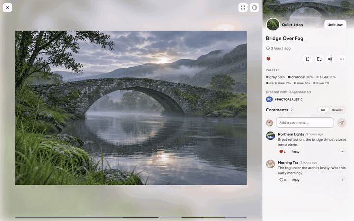
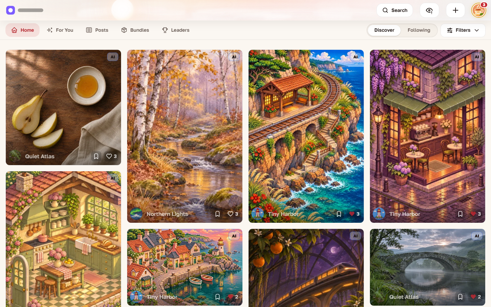
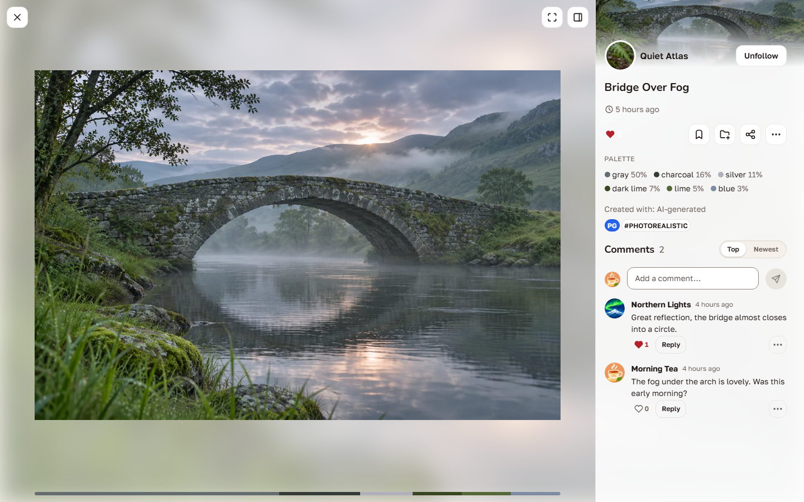
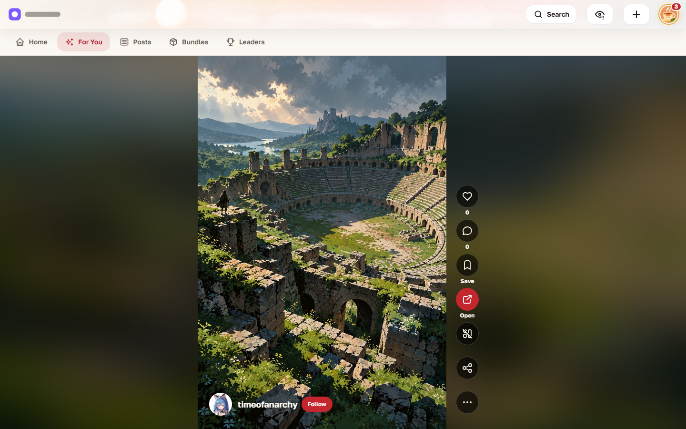
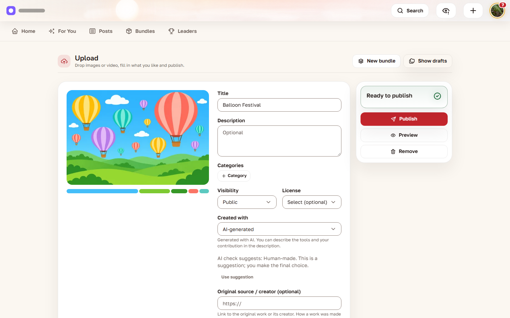
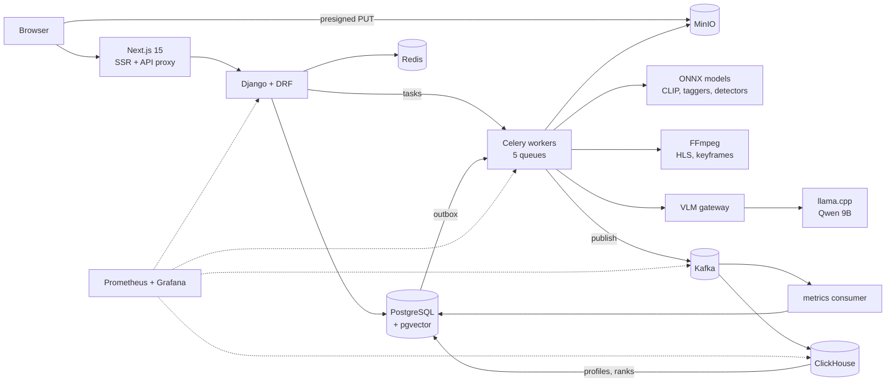
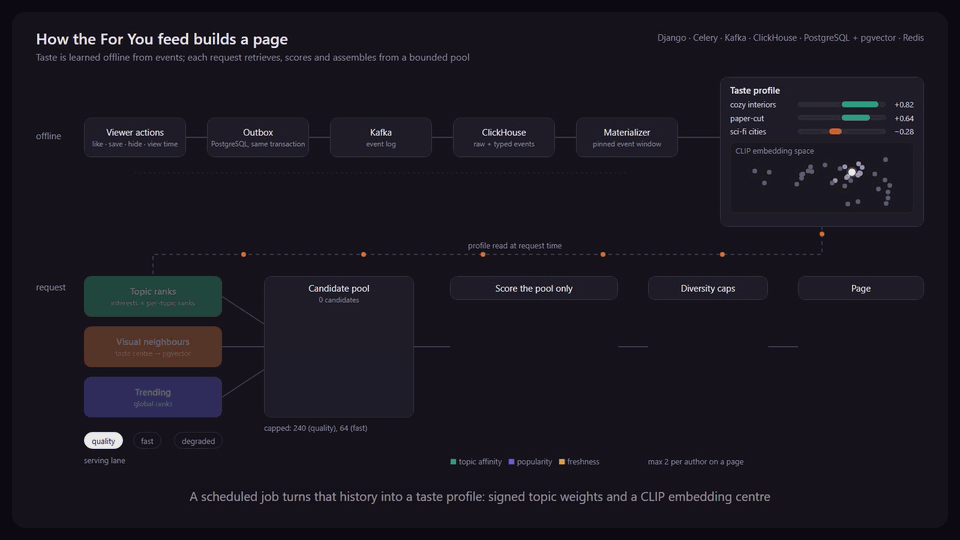

# UGC media platform

A platform where people publish images, videos, collections and long-form posts. Uploads go through an automated moderation pipeline before they can be published, and readers get a personalized feed.

I have been building it alone since August 2025: backend, frontend, ML pipeline and infrastructure. The repositories are private. This page describes how the system works; I am happy to walk through the code on a call or give read access on request.

[Demo video, 78 s, no sound](media/demo.mp4). All images in the demo are generated test data uploaded through the real upload API.

| Feed | Work page |
| --- | --- |
|  |  |
| **For You** | **Upload** |
|  |  |

## Stack

- **Backend:** Python 3.13, Django 5.2, Django REST Framework, Celery, Redis
- **Data:** PostgreSQL with pgvector, ClickHouse, Kafka with Schema Registry, MinIO (S3)
- **ML:** ONNX Runtime (CLIP ViT-L/14, image taggers, detectors), FFmpeg, a local Qwen 9B vision model served by llama.cpp
- **Frontend:** Next.js 15 (App Router), React 19, a server-side proxy layer in front of the API
- **Ops:** Docker Compose, Prometheus, Alertmanager, Grafana, GitHub Actions

## Architecture

The backend is split into ten Django apps (accounts, content, media, social, collections, taxonomy, gamification, analytics, observability, common). Their allowed imports are declared in a machine-readable file and checked by tests, so a domain cannot quietly start reaching into another one's internals.

## Design decisions

### Analytics never slows down a request

Views, likes and reading time are written to an outbox table in the same PostgreSQL transaction as the action itself. A Celery task drains the outbox to Kafka every 30 seconds and marks a row as sent only after the broker confirms delivery. Two consumers read the topic: one updates the counters shown in the UI, the other writes raw and typed events to ClickHouse. Both commit offsets only after their batch is stored, and both deduplicate by event id, so a replay does not double-count. Things that must be exact right away, such as "did I like this" or comment counts, stay in PostgreSQL and are updated synchronously.

### Personalized feed on CLIP embeddings and pgvector

[Full animation with the offline part, 52 s](media/for-you-architecture.mp4)

Every image and video poster gets a 768-dimensional CLIP ViT-L/14 embedding (FP16 ONNX), stored in PostgreSQL with pgvector. A scheduled job reads interaction history from ClickHouse and publishes, for each user, topic interests and an embedding centroid. A feed request collects a bounded candidate pool from three sources: per-topic ranks, nearest neighbours of the user's centroid, and global trending. It then scores only that pool (affinity, popularity, freshness), applies diversity caps and loads full records for the final page only. The service picks one of three lanes per request: `quality`, `fast` (no vector query, smaller pool) or `degraded` (global ranks only), depending on profile freshness and cache health. Access rules and blocks are applied again at hydration, so a cached candidate cannot leak something the viewer should no longer see.

### Moderation: no single model decides

An upload goes through a chain of Celery tasks: exact-hash check against a ban list, derivatives, CLIP embedding, ONNX taggers, specialised detectors, and for video HLS transcoding, keyframes and per-frame tags. Each step only records observations. The final rating and status are set by one policy step that combines tags, rules and detector results. For borderline cases it asks a vision-language model running locally in llama.cpp. The model sits behind its own gateway service with timeouts, backpressure and a supervisor that restarts it, and the backend is allowed to make the rating stricter based on its answer, never more permissive. If the model is unavailable or degraded, the publish gate decides per case whether the upload can go out or waits for a human moderator.

### Tests and CI as part of the design

The backend suite has about 5,900 pytest cases in 275 modules: unit tests, PostgreSQL regression and query-count budgets, and an integration contour that runs real MinIO, Celery, FFmpeg, Kafka and ClickHouse in Testcontainers. The frontend uses Vitest with Testing Library and MSW, and Playwright end-to-end tests in Chromium, Firefox and WebKit with axe accessibility checks. CI in GitHub Actions runs a secret scan (gitleaks), dependency audits (pip-audit, npm audit), OpenAPI contract tests, ClickHouse schema drift and data-governance checks.

## Measurements

Before changing a model I measure it offline on my own datasets. One example: comparing image taggers on a 1,024-image dev set (RTX 3080 Ti, ONNX Runtime with DirectML, fixed thresholds):

| Model | Micro F1 | Median latency | GPU memory |
| --- | ---: | ---: | ---: |
| PixAI v0.9 (current baseline) | 0.52 | 118 ms | 1,560 MiB |
| CAFormer B36 | 0.61 | 50 ms | 769 MiB |

CAFormer was 2.3 times faster and used half the memory. I also exported it in mixed precision (FP16 weights, FP32 normalisation): the file is half the size (269 MB vs 537 MB) and F1 stayed at 0.600. It is still a candidate, not the production model: on the moderation-relevant tags its recall was lower, and on a separate 128-image set with human-reviewed decisions no tagger was good enough to replace the full policy on its own. The labels in the dev set are incomplete crowd-sourced tags, so these numbers compare models with each other and are not an absolute quality score.

## Other numbers

- 63 Celery tasks across 5 queues (default, media, transcoding, VLM, analytics)
- about 3,300 backend test functions, about 5,900 cases with parametrization
- recommendation candidate pool capped at 240 items in the `quality` lane and 64 in `fast`

## Code access

The code is private. If you are reviewing my application, write to me and I will show the parts you are interested in: the outbox and Kafka consumers, the feed service, the media pipeline or the test setup.
